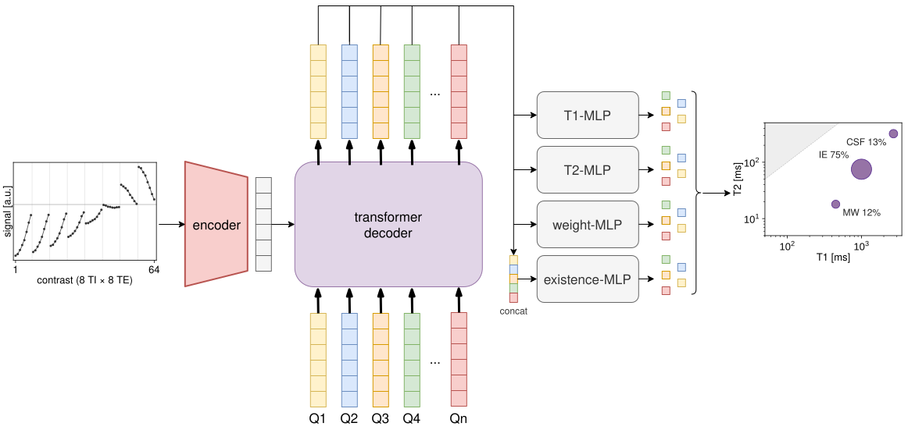

# T1-T2 DETR

Detection of microstructure compartments from inversion-recovery multi-echo T1-T2 signals
(8 TI × 8 TE) with a Detection Transformer, compared to regularized NNLS.
Code for the ISBI paper (synthetic data only).



The 64 L2-normalized signals (shown sorted by TI, then TE) are encoded into a hidden vector; ten learned queries
cross-attend to it in the transformer decoder. Per query, MLP heads predict T1, T2 and signal fraction; existence
scores are predicted jointly from the concatenated features of all queries. The output is a set of discrete
compartments (here myelin water, intra-/extracellular water and CSF partial volume; marker area ∝ signal fraction).

## Usage

```bash
pip install -r requirements.txt

python generate_data.py   # train / validation / test + paired SNR ladder           ~1 min
python train.py           # DETR (ours) and DETR (diffusion design), GPU             hours per variant
python run_nnls.py        # NNLS reference, CPU, parallel over voxels                ~15 min on 40 cores
python evaluate.py        # Table 1, Fig. 1-3, results.json                          minutes
```

Every setting lives in `t1t2detr/config.py`; the scripts take no required arguments.
One seed (`SEED = 42`) drives data generation, training, bootstrap resampling and the choice of example voxels.
`run_nnls.py` uses `$SLURM_CPUS_PER_TASK` workers if set, otherwise 40 (`--workers N` to override).
`train.py` and `run_nnls.py` are independent and can run in parallel.

## Outputs

| Path | Content |
|---|---|
| `data/` | `train`, `validation`, `test` (SNR ~ U(10, 150) per voxel); `snr5`, `snr10`, `snr20`, `snr40`, `snr80`, `snr120`, `snr200`, `snrinf` (same 5,000 voxels and noise draw, only the noise amplitude differs) |
| `models/<variant>/` | `model.pt` (best validation mAP@10), `history.json` |
| `predictions/` | `<method>_<case>.npz`, all methods in the same format (N, 10, 4): T1 [ms], T2 [ms], w, confidence |
| `results/table1.md` | NNLS / DETR (diffusion design) / DETR (ours) on the test set; paired bootstrap CIs of the differences |
| `results/fig1_spectra.pdf` | example voxels (n_c = 2, 3, 4, SNR 40): NNLS spectrum and peaks, DETR (ours), ground truth |
| `results/fig2_snr.pdf` | mAP@10 and strict accuracy vs. SNR with 95 % bootstrap bands; training SNR range shaded |
| `results/fig3_scatter.pdf` | true vs. predicted T1, T2, signal fraction of DETR (ours) |
| `results/results.json` | all numbers, thresholds and confidence intervals |

## Methods in short

- **Signal model**: S = Σ_k w_k (1 − 2 e^(−TI/T1_k) + e^(−TR/T1_k)) e^(−TE/T2_k), TR = 20 s, protocol in `protocols/ti_te_dict.mat`.
- **Data**: 1–4 compartments (balanced), T1 ∈ [50, 3500] ms and T2 ∈ [5, 500] ms log-uniform with T2 < T1,
  Dirichlet weights ≥ 0.05, Gaussian noise σ = max|S| / SNR. 200k / 25k / 25k voxels.
- **DETR**: MLP signal encoder, 4 transformer decoder layers, 10 queries, heads for T1, T2, w and existence (joint over all queries);
  Hungarian matching loss. Both variants share architecture, data and optimizer and differ only in
  - *ours*: log-scaled T1/T2 targets, uniform compartment weighting in the loss,
  - *diffusion design*: linearly scaled targets (T / T_max) and signal-fraction weighting, as in the diffusion DETR.
- **NNLS**: zero-order Tikhonov on a 30 × 30 log grid (T2 < T1), λ per voxel by the χ² criterion (χ² = 1.02 χ²_min),
  compartments = spectral peaks (hill climbing), confidence = peak fraction.
- **Evaluation**: a prediction matches a compartment if |Δlog T1| and |Δlog T2| are both ≤ τ of the log range;
  101-point mAP at τ = 5 % and 10 %; strict accuracy = correct number of compartments and all matched.
  Confidence thresholds are chosen per method on validation (best F1). Confidence intervals: paired bootstrap over
  voxels (1000 resamples, same resamples for all methods).

## Reproducibility

Data generation, NNLS and evaluation are deterministic. Training uses deterministic PyTorch settings and a
seeded data order; it is bit-reproducible on the same hardware and software stack, while a different GPU or
CUDA/PyTorch version can give slightly different numbers.
